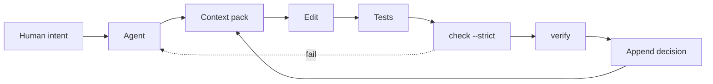

# steadfast-docs

**Repository memory for AI coding agents.**

Documentation that only agents read. A new session resumes where the last one stopped; humans ask, agents remember, and CI keeps the memory honest.

[](https://www.npmjs.com/package/steadfast-docs)
[](https://github.com/done6666/steadfast-docs/actions/workflows/ci.yml)
[](https://github.com/done6666/steadfast-docs/tree/main/test)
[](https://github.com/done6666/steadfast-docs/blob/main/package.json)
[](https://github.com/done6666/steadfast-docs/blob/main/LICENSE)

## Why

Large projects outlive a context window. Agent-written documentation fails in three ways:

1. **It forgets.** The context fills, a new session starts, and the in-progress state (what is done, what is next, what is still a guess) is gone.
2. **It rots.** A decision changes in conversation but not in the file. Copies multiply, and the agent follows the wrong one.
3. **It floods the context.** A project with 40 ADRs is roughly 50K tokens. Accuracy drops as input grows, so the agent pays more and reasons worse, and skips docs it was told to read.

Adding more documentation makes all three worse.

## The idea

Store only what code cannot prove: the rule, the reason, and the alternatives already rejected.

| Artifact | What it is | Budget |
| --- | --- | --- |
| **Invariants** | 10–25 laws, always loaded | ~400 tokens |
| **Decisions** | append-only YAML, never edited | ≤160 tokens each |
| **Guards** | `deny` / `instead` / `check` | ≤3 per decision |
| **Checkpoint** | where the last session stopped, rewritten in place | 1 next, ≤3 done, ≤2 open |
| **Context pack** | compiled per task, only matching records | hard token cap |

No compiled state is committed. The pack is generated on demand, so there is no second copy to go stale.



## Quick start

One-time setup. After this, you do not run the loop; the agent does.

```bash
npx steadfast-docs init
npx steadfast-docs mcp install --platform opencode   # or --platform claude
npx steadfast-docs hook install --platform opencode  # or claude: pushes the brief into new or compacted sessions
npx steadfast-docs skill install --platform opencode
```

`init` writes `.steadfast/` and appends the contract to `AGENTS.md`. `mcp install` gives the agent native tools, `hook install` gates commits (and with `--platform` pushes the brief into new or compacted sessions), and the skill teaches the loop. From then on, you talk to the agent:

> “Add a refund endpoint.”

The agent reads the brief, resumes from the checkpoint, plans the paths, calls `context`, reads only the pack, implements, runs the tests, calls `check` and `verify`, rewrites the checkpoint, and appends a decision when it made a non-obvious choice. You see a short summary and the decisions that need approval — never a document to review.

`context --for` accepts files, directories or globs. A directory expands to the files beneath it, and a glob expands to the files it matches, so `src/core` finds a rule declared for `src/core/pack.ts`. A selector that matches no decision is called out in the pack; `--strict` turns that into a failure.

## Native agent tools

`mcp install` registers a local stdio server with the agent:

| Platform | Config written | Tool prefix |
| --- | --- | --- |
| OpenCode | `.opencode/opencode.json` (`mcp.servers.steadfast`) | `steadfast_*` |
| Claude Code | `.mcp.json` (`mcpServers.steadfast`) | `mcp__steadfast__*` |

The server exposes `brief`, `context`, `check`, `verify`, `new`, `finding`, `explain`, `supersede` and `doctor`. It is a JSON-RPC wrapper over the same CLI, so there is one implementation and two entry points. `--print` shows the config without writing it; `--check` verifies an existing install.

`hook install` adds a managed block to the real git hooks directory (respecting a repo-local `core.hooksPath`, worktrees and submodules) that runs `check --strict --staged --diff HEAD`. `--staged` refuses to validate a working tree that differs from the index, so what the hook approves is what the commit contains. An existing hook is chained as `pre-commit.steadfast-original` (non-shell hooks included), runs before the check, and is restored by `hook remove`. A hooks directory shared outside the repository is refused, because a project-specific hook would run in every repo.

`hook install --platform claude` also adds a `SessionStart` hook to `.claude/settings.json` that runs `brief`. Every new, resumed, cleared or compacted Claude Code session starts with the current step and its checkpoint, so the agent never has to remember to ask. Other hooks and settings are preserved, and `hook remove --platform claude` takes out only this entry.

`hook install --platform opencode` writes a managed plugin, `.opencode/plugins/steadfast-brief.js`, for OpenCode's `experimental.session.compacting` hook (experimental upstream, so it may change). When a session fills up and compacts, the plugin runs the project's own `brief` (the CLI in `node_modules`, the local build, or `npx`) and adds it to the compaction context, so the summary the session continues from carries the current step and its checkpoint. If `brief` fails, the plugin tells the agent to run it instead. OpenCode documents no session-start context hook, so a brand-new session still relies on the `AGENTS.md` contract to run `brief`. `hook remove --platform opencode` deletes only that file, and a plugin file steadfast did not write is never overwritten or removed. `doctor` then reports the contract, skill copy, MCP config, hook, freshness, advisory rules and retired docs in one pass.

## What a decision looks like

```yaml
id: ADR-0012
topic: http-client
scope: billing
status: active
applies_to: [src/billing/**]
decision: All outbound HTTP goes through src/api/client.ts.
why: [Retry and timeout live in one place.]
guards:
  - deny: "src/billing/** fetch"
    instead: src/api/client.ts
    check: eslint no-restricted-imports
enforced_by: test/api/client.contract.test.ts
verified_by: h1:...
```

About 90 tokens. The 150-line ADR it replaces is closer to 3,000.

## What a roadmap looks like

Decisions say what must stay true; the roadmap says what to do next.
`.steadfast/roadmap.yaml` is mutable execution state, not a second decision store.

```yaml
version: 1
updated: 2026-10-27
steps:
  - id: STEP-003
    goal: Add the maintenance cleanup job
    why: Inactive users keep notification rows forever
    paths: [apps/worker/src/handlers/**, packages/jobs/src/**]
    acceptance: pnpm test --filter worker
    status: current
    decisions: [ADR-0017]
    checkpoint:
      next: Wire the cleanup job into the scheduler
      done: ["Migration and handler"]
      open: ["Retention window of 90 days is a guess"]
```

One step is `current`; `done` requires evidence (a test or commit). `brief`
compiles a ≤300-token session view — current step and checkpoint, next steps,
blockers, recent commits, worktrees and memory stats — and stores nothing. The
full roadmap is never loaded into context.

The checkpoint is where the last session stopped: the next concrete action,
what is done, and what is still open. It is rewritten in place, never
appended. `check --diff` fails when the current step's paths change but its
checkpoint does not, so every commit leaves a resume point even if the context
runs out mid-task. Done steps carry none; lasting facts move into findings or
decisions.

## What a finding is

Decisions say what must stay true; findings say what is true about a versioned
target. They are for facts code cannot prove *yet*: an offset, a protocol
detail, an observed behaviour. One finding is one fact and one piece of
evidence.

```yaml
id: FIND-0001
topic: health-offset
scope: client
status: active
target: game-client@1.2.3
claim: Health is a float at 0x1A2B3C.
evidence: scripts/re/health.py
confidence: high
observed_at: 2026-10-27
applies_to: [src/features/wallhack/**]
```

Findings enter a pack only when `applies_to` matches. Retracted findings become
`do_not_revisit`; retired findings disappear once a test proves them. They are
append-only: correct one by appending a successor with `supersedes`.

## Why it does not rot

- **Append-only.** Change a rule by appending a record with `supersedes: [ADR-0012]`. `superseded` is derived, never written. Two active records cannot share a `(scope, topic)`.
- **Content fingerprints.** `verified_by` hashes the files matched by `applies_to`, not a commit sha. Verify before committing; rebases cannot invalidate it.
- **Declared enforcement.** `enforced_by` is a test path or a `!command`. `check` verifies that a test path exists but never runs it; `verify --assume` is an explicit assertion that the test passed. Rules without one are advisory and are flagged after `advisory_ttl_days` (a failure under `--strict`).
- **Resume points move with the work.** A commit that touches the current step without rewriting its checkpoint fails `check --strict`.
- **Hard budgets.** Per record, per pack, per invariant list, enforced against a conservative token estimate. `context` exits 2 with the token or guard count needed, so the agent can ask before raising the budget; `--budget` may only lower the configured cap, and `--allow-partial` is the explicit escape hatch.
- **Negative memory.** Rejected proposals are first-class records, so the agent does not re-litigate dead ends.
- **Retired docs stay retired.** `retire` deletes the old documentation and records the glob; `check` fails if it reappears. In a git worktree it stages the deletion and the config update, so `check` sees the retired state immediately; `--no-stage` leaves both for selective staging. Git history is the archive.
- **Agent-native.** The MCP server and CLI share one contract; the pre-commit hook enforces `check` even when the agent forgets.
- **Decision debt.** `check --diff main` flags dependency and build changes that arrived without a decision.

## Commands

| Command | Purpose |
| --- | --- |
| `npx steadfast-docs init [--adopt]` | Scaffold `.steadfast/` and the `AGENTS.md` contract |
| `npx steadfast-docs brief` | Compile the current step, blockers, recent commits and memory stats |
| `npx steadfast-docs context --for <paths>` | Compile the token-budgeted pack for a task (files, dirs or globs) |
| `npx steadfast-docs check --strict --diff main` | Validate schema, graph, freshness, paths, budgets and history |
| `npx steadfast-docs new ...` | Append a decision record |
| `npx steadfast-docs finding new\|supersede\|retract\|retire\|explain` | Record, correct or retire an observation |
| `npx steadfast-docs explain <id>` | Inspect one record, its status and successor |
| `npx steadfast-docs supersede <id> --decision <text>` | Append a successor; the old record is derived as superseded |
| `npx steadfast-docs verify <ids> --assume` | Recompute fingerprints after the tests pass |
| `npx steadfast-docs retire <path> --apply [--no-stage]` | Delete legacy docs, stage the change and enforce `retired_docs` |
| `npx steadfast-docs mcp install` | Register the MCP server (or run `mcp` to start it) |
| `npx steadfast-docs hook install [--platform claude\|opencode]` | Add the managed pre-commit `check` and the session-start or compaction brief |
| `npx steadfast-docs doctor` | Diagnose contract, skill, MCP, hook, freshness and advisories |
| `npx steadfast-docs skill install --platform opencode` | Install the agent loop (or `claude`) |

## Evidence

`benchmarks/pilot` is a synthetic multi-tenant billing ledger with a 10.5k-token legacy docs set and four contradictions.

| Mode | Tasks | Passed | Avg context |
| --- | ---: | ---: | ---: |
| baseline (legacy docs) | 6 | 5 | 10,459 |
| steadfast | 7 | 7 | 681 |
| steadfast-retired | 1 | 1 | 777 |

The main six tasks both passed; the win was **~15x less required context**. The seventh task was non-inferable: the docs put the refund cap in the nightly reporting job, the pack put it in the API. The baseline failed; the pack passed with the docs present and after `retire` deleted them. Staleness, duplicate topics and edited history were detected deterministically, while the legacy docs carried four undetected contradictions.

[Full pilot report →](https://github.com/done6666/steadfast-docs/blob/main/benchmarks/pilot/RESULTS.md)

### Real-project pilot

A second pilot migrated the job architecture of a production-shaped monorepo
from one 3.2k-token document into 18 decisions and 4 invariants on a side
branch. Task packs ranged from 149 to 608 tokens; five contract tasks used about
1.7k tokens total against about 8.9k for the document baseline (~5x). The legacy
document was retired after migration. Five of the 18 rules stayed advisory, and
converting prose into decisions was the slow part. One project, one trial per
task: this is evidence that the loop works outside a synthetic fixture, not a
statistical result. [Pilot notes →](benchmarks/real-01/README.md)

## Adopting an existing repo

```bash
npx steadfast-docs init --adopt
# let the agent draft invariants and decisions
npx steadfast-docs check --strict
npx steadfast-docs retire legacy-docs --apply
```

`retire` is a dry run by default. It refuses source files, the root `README.md`, `AGENTS.md` and symlinks. `--apply` deletes the documentation, records `legacy-docs/**` in `retired_docs`, and stages both changes when run inside a git worktree; `--no-stage` leaves them unstaged. `check` fails if the docs return.

## What it is not

- Not a memory bank or a RAG store. Those recall what happened; this records what was decided and detects when the record or the code it governs drifts.
- Not a knowledge base. Findings are one-fact, versioned observations with evidence; they retire when code proves them.
- Not human documentation. In a steadfast project, humans talk to the agent and read code; the memory is machine-first.
- Not a documentation generator. If a fact can be derived from code, derive it; do not store it.

## FAQ

**Do I have to run the commands?** No. `init` and `skill install` are one-time; after that the agent runs the loop. `check` in CI is the gate.

**Does it work with Claude Code, Codex, Cursor?** `mcp install` supports OpenCode and Claude Code; the skill installs for both. Any harness that can run shell commands can use the CLI, and `AGENTS.md` is the contract.

**What happens when a decision changes?** Run `steadfast supersede <id> --decision "<rule>"`; it inherits enforcement and guards, and the old record resolves to superseded. Never edit an active record. `check --diff main` rejects edits, deletions and renames.

**What if the pack is over budget?** `context` stops, prints the current and needed token or guard counts, and the agent is instructed to ask you before changing `.steadfast/config.yaml` or passing `--allow-partial`. A local `--budget` cannot raise the configured cap.

**What if the agent ignores the contract?** The commit or PR fails `check --strict` for memory violations (edited history, stale fingerprints, budgets, retired docs). A code-level rule is only as strong as the `enforced_by` test or linter behind it.

**Is it production-ready?** The protocol and CLI are covered by tests, and one real project has completed the migration. That is still a small sample. Start with a non-critical repo.

## Development

Requires Node 20.11+.

```bash
npm install
npm run build
npm test
node dist/src/cli.js check --strict
```

`verify` runs record-supplied `!commands` only with `--trust`. A CI sequence is: run the test suite, then `steadfast verify --all --assume` (add `--trust` for `!command` records), then `steadfast check --strict`. For a subset, use `steadfast verify <ids> --run "<suite>"`.

## Status

0.5.0 published. The agent-native slice is complete: `init`, `brief`, `new`, `finding`, `explain`, `supersede`, `context`, `check`, `verify`, `retire`, `skill`, `mcp`, `hook`, `doctor`.
Unreleased: roadmap checkpoints that a commit must move, and a Claude Code session-start brief.
A real-project pilot has completed and is kept as a lab branch, not adopted. Next is a new adoption pilot; task-scope contracts (`start` / `check` / `end`) only if real use needs them.

## License

MIT
